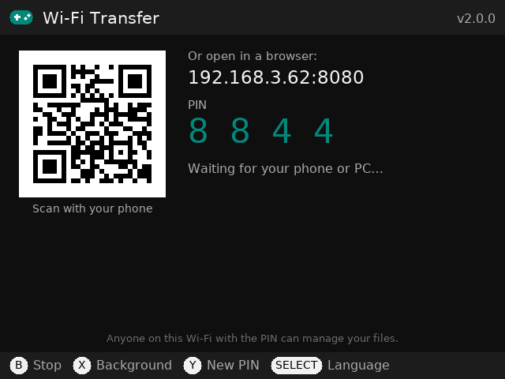
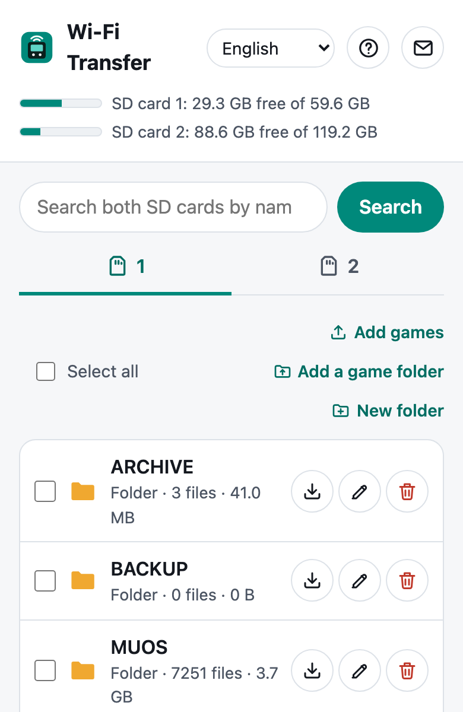
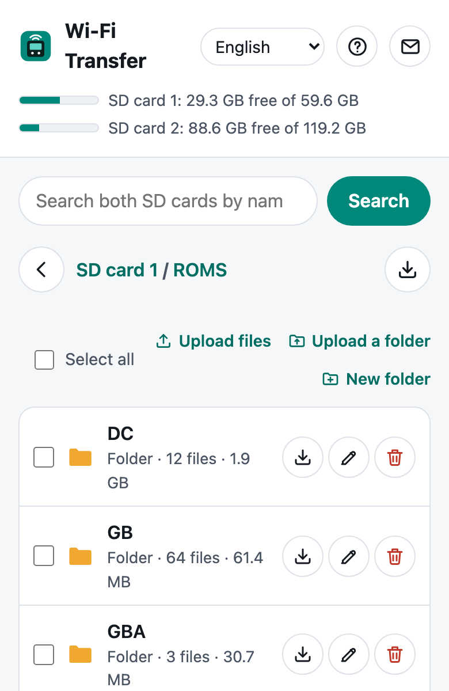
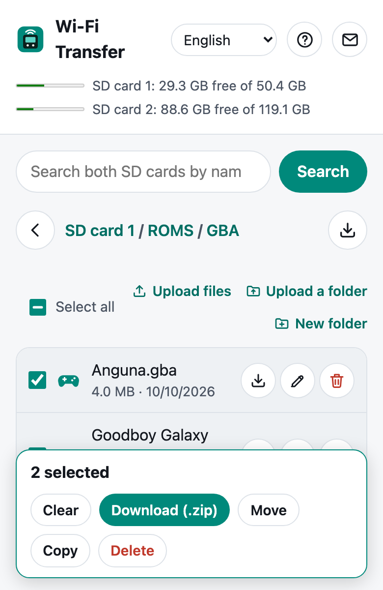
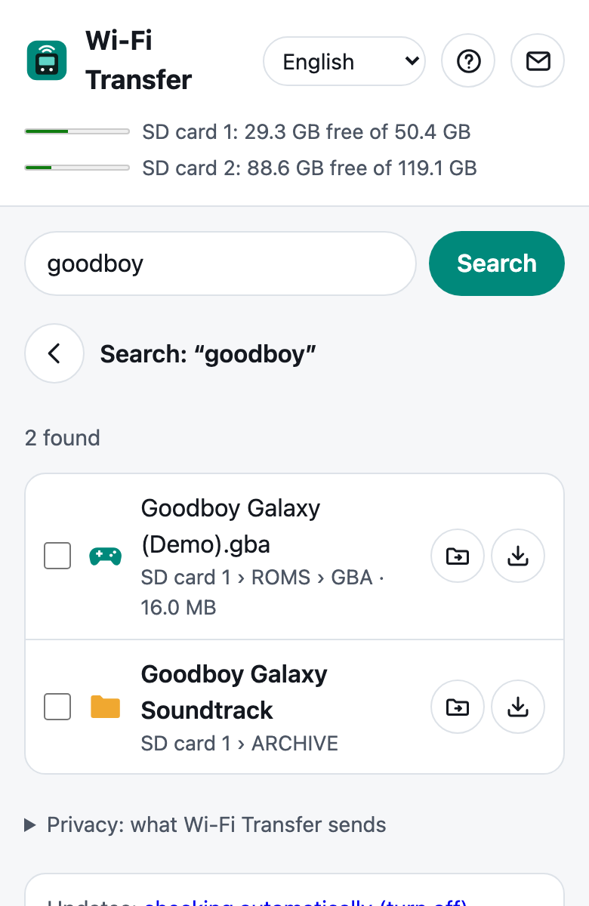
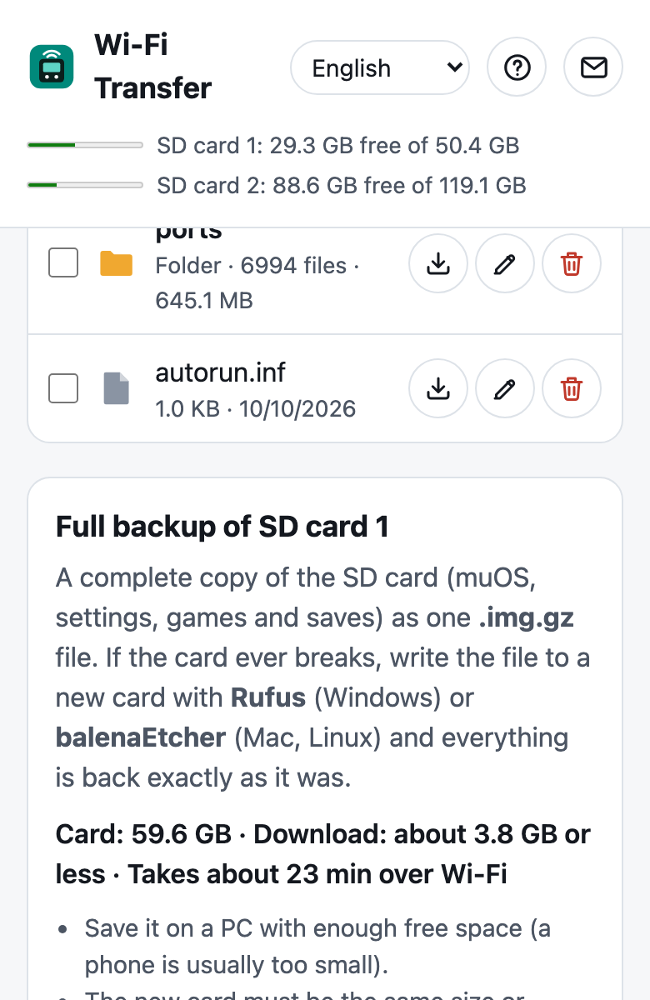
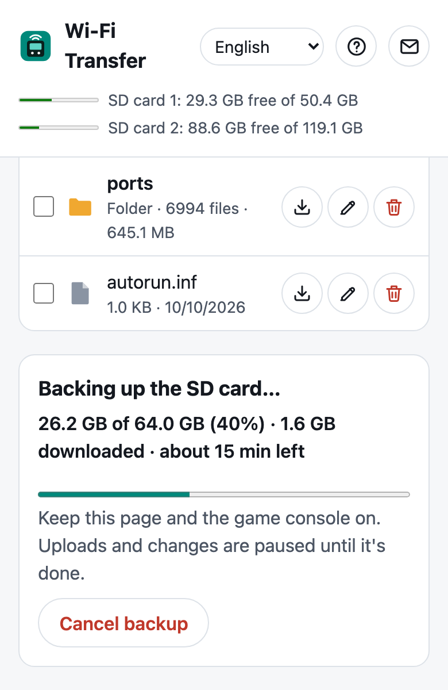

# Wi-Fi Transfer

**Move files to and from your muOS game console from any phone or PC browser**, and back up the whole SD card. No
cables, card reader or extra apps needed.

[Download](https://pocketkode.com/apps/wifi-transfer/) ·
[Blog: back up your SD card](https://pocketkode.com/blog/backup-restore-muos-sd-card/) ·
[Blog: free blocked space](https://pocketkode.com/blog/free-blocked-space-muos-sd-card/) ·
[pocketkode.com](https://pocketkode.com)

***

- **SD card 1 and SD card 2** tabs show each card as it is, every folder and file with its size; the top of the page
  shows each card's free space.
- **Add games** and **Add a game folder** on a card's tab: each game goes to the right folder on that card
  (`.gba` → `ROMS/GBA`), `.muxapp` apps go to `ARCHIVE`. Inside a folder, **Upload files** and **Upload a folder** put
  things exactly there.
- **Search** both cards by name.
- **Select several items** to download them as one `.zip`, move or copy them (to either card), or delete them.
- **Full backup of SD card 1**: the whole card (muOS, settings, games, saves) as one `.img.gz` file. Write it to a new
  card with Rufus or balenaEtcher and everything is back.
- **Background:** press **X** on the game console to go back to the muOS menu or play while the page keeps working.
- **9 languages** on the game console and the page: English, 日本語, Español, Français, Deutsch, Nederlands, Русский,
  简体中文 and 한국어.

## Gallery

| | | |
|---|---|---|
|  |  |  |
|  |  |  |

## Installation

1. Download `WiFiTransfer-X.Y.Z.muxapp` from **[pocketkode.com/apps/wifi-transfer](https://pocketkode.com/apps/wifi-transfer/)**
   (or from the [latest release](https://github.com/pocketkode/wifi-transfer/releases/latest) here). The SHA-256 is on
   both pages.
2. Copy it to the `ARCHIVE` folder on SD card 1 (with a card reader, or with muOS's own SFTP).
3. On the handheld, open **Applications → Archive Manager** and install it. Then open **Applications → Wi-Fi Transfer**.

New to `.muxapp` files? See [Install apps on muOS with Archive Manager](https://pocketkode.com/blog/install-apps-muos-archive-manager-muxapp/).

Tested on the Anbernic RG40XXH with muOS 2601.0 Jacaranda. Other muOS devices with Wi-Fi may work: reports are welcome.

## Quick start

1. Turn on Wi-Fi on the game console (**Configuration → Network**) and open **Applications → Wi-Fi Transfer**.
2. On your phone, **scan the QR code**, or type the address shown (e.g. `http://192.168.1.23:8080`) into a browser on a
   phone or PC on the **same Wi-Fi**.
3. Enter the **PIN** shown on the game console.
4. Pick a card tab. **Add games** puts each game in the right folder; tick items to download, move, copy or delete
   them; search finds files on both cards.
5. When you're done, press **B** on the game console. **X** keeps it running in the background instead.

The **?** button on the page opens the full guide.

## Controls on the game console

| Button | Action |
|---|---|
| B | Stop and quit (asks again if something is still transferring) |
| X | Keep running in the background |
| Y | New PIN (logs everyone out) |
| A | Start again after an automatic stop |
| SELECT | Change the language of the game console's screen |

## Tips

- **Back up before big changes.** The full backup holds your games, saves and BIOS files: keep it private. Step by step,
  with restoring: [Back up and restore your muOS SD card](https://pocketkode.com/blog/backup-restore-muos-sd-card/).
- **A card that looks full** but has few files may have blocked space; see
  [Free blocked space on a muOS SD card](https://pocketkode.com/blog/free-blocked-space-muos-sd-card/).
- **New games don't show in muOS?** Quit Wi-Fi Transfer with **B** and open the system's folder again.
- **Updates:** when a new version is out, the game console shows it; install it when you choose. Your settings stay.
  The check can be turned off at the bottom of the transfer page.

## Security

- The transfer page runs only while Wi-Fi Transfer is open or running in the background, and stops by itself after
  **15 minutes** without activity.
- It's reachable only from your **local network** and needs a **new random PIN** each time (**Y** makes a new one and
  logs everyone out). **5 wrong PINs** lock that device out for a minute.
- It shows everything on your SD cards, including muOS's own files in `MUOS`: deleting, renaming or moving anything
  there asks first.
- The page uses plain `http://` on your home network, like most device apps. Don't run it on public Wi-Fi.

## Troubleshooting

| Problem | What to do |
|---|---|
| The page doesn't open | Check that the phone or PC is on the same Wi-Fi as the game console, and type the address exactly as shown. |
| It stopped by itself | It stops after 15 minutes without activity: press **A** on the game console to start again. |
| Still stuck? | Email **feedback@pocketkode.com** with `logs/app.log` from the app's folder, or open an [issue](https://github.com/pocketkode/wifi-transfer/issues). |

## Privacy

Your files go only between this game console and **your own** phone or PC. They never go over the internet, and Wi-Fi
Transfer never reads or sends them anywhere else. To check for updates it reads the latest release on **GitHub** (you
can turn this off at the bottom of the transfer page); an update you choose to install is downloaded from pocketkode.com
and checked (SHA-256 and PocketKode's signature) before anything changes. It sends nothing about you or the game
console. No ads, no analytics, no tracking. More on [pocketkode.com/privacy](https://pocketkode.com/privacy/).

## Build

`bash build.sh` (needs bash, curl, unzip, zip, shasum and python3) produces `dist/WiFiTransfer.muxapp`: the app's
Python source and transfer page as they are, plus PySDL2, segno and the fonts. The app uses the Python 3, SDL2, SDL2_ttf
and SDL2_image that come with muOS.

## Third-party components

Bundled in the package, unmodified, each under its own license (texts in the `licenses/` folder; details in
[THIRD-PARTY-NOTICES.md](THIRD-PARTY-NOTICES.md)):

- **PySDL2** ([py-sdl/py-sdl2](https://github.com/py-sdl/py-sdl2)), © Marcus von Appen, CC0 or zlib: Python bindings
  for SDL2.
- **segno** ([heuer/segno](https://github.com/heuer/segno)), © Lars Heuer, BSD 3-Clause: the QR code on the game console.
- **DejaVu Sans** ([dejavu-fonts](https://dejavu-fonts.github.io/)), Bitstream Vera Fonts license: Latin and Cyrillic
  letters and symbols.
- **Noto Sans JP, SC and KR** ([notofonts/noto-cjk](https://github.com/notofonts/noto-cjk)), © Adobe and Google, SIL
  Open Font License 1.1: the fonts for Japanese, Chinese and Korean.

## Acknowledgments

- [PySDL2](https://github.com/py-sdl/py-sdl2) and [segno](https://github.com/heuer/segno), for great libraries that
  made the game console's screen and its QR code easy.
- [Rufus](https://rufus.ie) and [balenaEtcher](https://etcher.balena.io), which write the backups back to a card.
- The [muOS](https://muos.dev) team, for the system Wi-Fi Transfer runs on.
- Everyone who reports bugs and ideas.

Wi-Fi Transfer is an independent app, not affiliated with any of them, muOS or Anbernic.

## License

© 2026 PocketKode. Wi-Fi Transfer is free software under the **GNU General Public License v3** (GPL-3.0-only): you may
use, study, change and share it under that license; see [LICENSE](LICENSE). Bundled third-party parts keep their own
licenses (see the `licenses/` folder).

The name "PocketKode", the name "Wi-Fi Transfer" as used by PocketKode, and the PocketKode and app icons are not
covered by the GPL. If you share a changed version, please give it a different name and icon.

Bug reports and ideas: **feedback@pocketkode.com** · [pocketkode.com](https://pocketkode.com)
